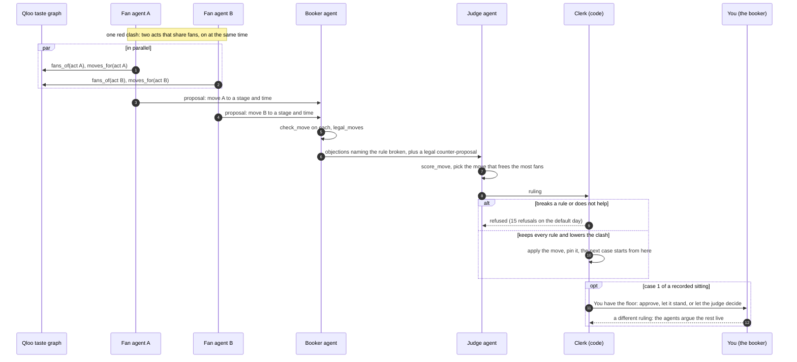
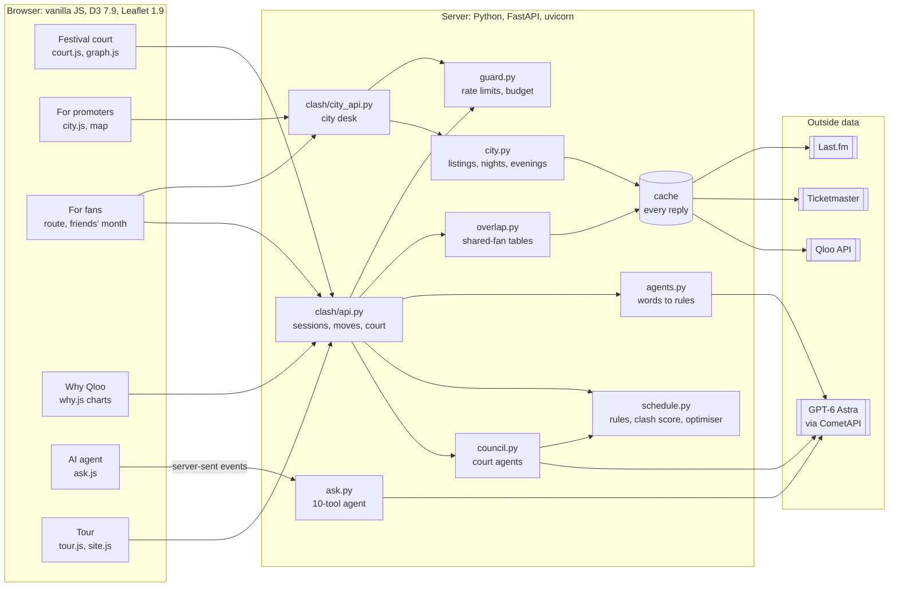
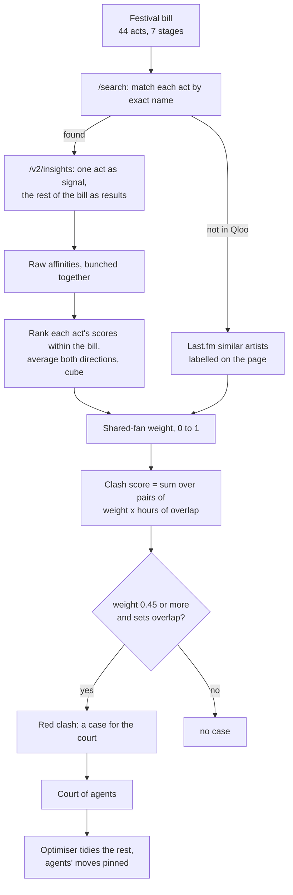
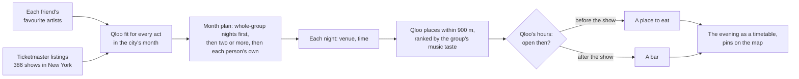
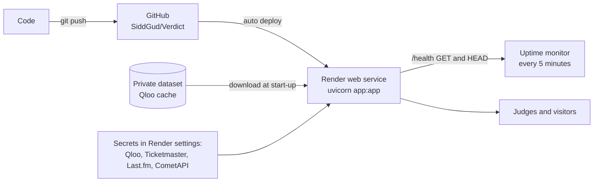

# Verdict

**Fans shouldn't have to choose.**

Verdict is an agentic system for live music, built on Qloo's taste graph. It finds which acts share fans, then acts on
it: a court of AI agents puts every festival timetable clash on trial and rebuilds the day without breaking a single
festival rule; promoters see which nights and which of their own shows compete for the same fans; fans get a day and a
month of nights out planned around the artists they love, with food and drinks to match.

In **28 pre-registered tests over 22 days**, Qloo made **GPT-6 Astra**, OpenAI's frontier reasoning model, measurably
better against real-world data.

**[Try it live](https://clash-court-1s4a.onrender.com)** · **[Watch the 2-minute tour](https://clash-court-1s4a.onrender.com/?watch=1)** ·
**[Everything in one file: llms.txt](llms.txt)** · [Test 28 protocol](PREREGISTRATION_28.md) · [Project log](PROJECT_LOG.md)

Qloo Agentic Hackathon 2026 · Athmeeya M Kashyap and Siddhant Gudwani · MIT licence

---

## Twelve facts

1. **Qloo made GPT-6 Astra better at ranking real shared fans:** 0.697 alone, **0.728** with Qloo, +0.031, 95% interval
   [0.005, 0.056], **significant** (Test 28).
2. **With Qloo, the small Gemini 3.8 Flash scored above GPT-6 Astra alone:** **0.723 against 0.697** (Gemini's own gain,
   +0.028, is significant; the gap to GPT-6 Astra alone is not).
3. **Without Qloo, the model changed 46 of 903 pair scores** between two identical requests. **With Qloo: 0.**
4. **Friday closing time for 30 real NYC restaurants:** GPT-6 Astra alone **0/30**, Gemini 3/30; **with Qloo, 29/30** (Test 20).
5. **Qloo found 119 of 120 places** a model named in its own plans (Test 22).
6. **The court cut a real Lollapalooza day's clash score from 10.85 to 5.92, 45% fewer, with 0 rules broken.**
7. **Code refused 15 rule-breaking agent proposals** in one sitting.
8. **6 of the court's 9 moves were ones the optimiser alone would not have made.**
9. **The path judges use most costs $0 in model calls:** about 76 cached Qloo calls per festival day.
10. **51 same-fan show pairs within a week in Live Nation's real New York month; 17 red clashes on one Lollapalooza day.**
11. **28 pre-registered tests over 22 days,** protocols committed before results, two model families, 95% intervals.
12. **Where a frontier model leads, Verdict says so and uses it:** openers and tour order are model-led, Qloo-checked.

---

## The problem, and why it is worth solving

Two acts that share fans, on two stages, at the same time: someone misses one. Festivals publish timetables full of
these clashes because nobody puts a number on shared audiences before tickets go on sale. Promoters book shows that
draw the same people on the same night. Fans plan their days and nights around a few artists with no help joining them up.

| | |
|---|---|
| **$40B+** | live music ticket sales worldwide in 2025, heading to $50B by 2030 (Omdia) |
| **159M fans, 55,000 shows** | Live Nation alone in 2025; $25.2B revenue, $20.9B of it concerts |
| **170+ acts, 8 stages, 4 days** | one Lollapalooza; its 2024 edition brought over $440M to Chicago |
| **17 clashes** | on one real day we tested (Lollapalooza Thursday 2024) |

**The vision: the audience layer for live music.** Every booking, timetable, marketing and night-out decision depends on
which acts draw the same people. Verdict turns that into a number and puts AI agents to work on it. One engine, three
markets: festivals (per edition), promoters and booking agents (subscription), ticketing platforms (API), and fans
(free, with partner bookings for restaurants and bars). This is a plan; the product and its tests are real today.

---

## Judging criteria

### Technological implementation: how thoroughly Qloo is used
Qloo is the scoring function for every feature, in four distinct uses, each backed by a test:

| Qloo call | What it powers | Tested in |
|---|---|---|
| `/search` | every act matched by exact name, with ID, photo, description | 38 of 44 acts; 119 of 120 places |
| `/v2/insights`, artist to artist | the shared-fan table for a whole festival bill or a city's month | Test 28 |
| `/v2/insights`, fan to artist | a fan's fit for every act; a group's month of nights out | Tests 27, 28 |
| `/v2/insights`, music taste to places | where to eat before a show and drink after, with Qloo's opening hours | Tests 12, 20 |

### Design: a complete product
One site organised by audience (Festival court, For promoters, For fans, Why Qloo), dark by default, a 2-minute tour
that plays itself, explanations folded behind "How it works", phone-ready, reduced motion honoured.

### Potential impact: a real problem, a real audience
Three paying audiences in a $40B+ market; measured on real data: 17 same-fan clashes on one festival day, 51 same-fan
show pairs in one promoter's month.

### Quality of the idea: a creative, non-obvious use of Qloo
A taste graph used to keep audiences *apart*, not to recommend more of the same; Qloo's pair affinity turned into an
objective a court of agents can argue over, with a human booker who can overrule; the same overlap reused across
festival, city and evening.

### Why it cannot work without Qloo
Without Qloo, a model must score every pair and changes its answers (46 of 903) when asked twice; it ranks real shared
fans worse (0.697 against 0.728 with Qloo); it cannot say when a restaurant closes (0 of 30). **Qloo measures, the
agents argue, code decides.**

---

## Agentic capabilities

| Capability | In Verdict |
|---|---|
| **Autonomous reasoning and planning** | Fan agents find and propose moves; the judge weighs proposals; the optimiser plans the rest of the day |
| **Tool use and action execution** | 5 court tools and 10 agent tools over real data; accepted moves change the live timetable |
| **Multi-agent collaboration** | Fan agent A and fan agent B in parallel, then the booker, the judge, and the clerk (code) |
| **Memory and context** | The server holds each session's timetable; every case is argued on the result of the last; the chat agent keeps the conversation |
| **Human in the loop** | The booker's gate on case 1, drag and drop, plain-word emergencies, Undo |
| **Verification and safety** | Code refuses any rule-breaking or unhelpful move (15 refused, 0 rules broken); every number in an agent's answer is checked against its tool results |
| **Reliability** | Recorded sittings replay instantly; failed sittings are never saved; fallback to the optimiser; retries when a provider is busy |

### The court, one case



---

## Everything it does

**Festival court (front page)**
- 2-minute self-playing tour; Enter the courtroom; Talk to the AI agent; section buttons.
- The court: recorded sitting (instant, free) or live (streamed); each case with photos, descriptions, tool calls,
  statements, proposals; the booker's gate; docket; a judgment showing who decided each move and both scores.
- Booker's emergencies in plain words ("Tyla just cancelled", "Kesha arrives at 4pm", "keep Hozier and Lizzy McAlpine apart").
- Timetable: red, pink and Last.fm cells; clash lines that light up on hover; a slider for the clash threshold; drag any
  set with a live red or green preview, rule checks and Undo.
- The bill as Qloo sees it: a photo graph of shared fans, published and after the court.
- Bring your own lineup: paste 4 to 80 sets, matched in Qloo with progress streamed.
- Five real Lollapalooza days (2024, 2026) and a short description beside every act.

**For promoters**
- Map with pins for the shows that pull hardest on an artist's fans.
- Book a date: every night of the month scored; best nights, nights to avoid, partners to market alongside.
- Promoter portfolio: own shows that compete (same night), sequence (within a week) or co-promote.
- Openers and tour routing (model-led, Qloo-checked). New York and Chicago, November 2026, loaded ahead.

**For fans**
- Plan my day: every act scored for your taste; the best path; unavoidable clashes filed with the court.
- Friends' month with food and drinks: a calendar, a dated agenda, and each night as a timetable (a place before, the
  show, a bar after), matched by Qloo to the group's taste and open at those hours; pins on the map; tickets.

**Why Qloo**
- Interactive charts: answer rings, alone-vs-with-Qloo dumbbells, Qloo against popularity, identity, and a grid of
  answers that change when asked twice. Eight test cards. Live numbers for the chosen day.

**Ask the AI agent:** plain words, 10 tools, every call shown, every number checked.

---

## Architecture

### System



### From Qloo to a clash score



### A night out with friends



### Deployment



### Technical details

| Area | Detail |
|---|---|
| Clash score | sum over pairs of shared-fan weight (0 to 1) x hours of overlap; red at weight 0.45 or more |
| Weights | Qloo affinities ranked within the bill, both directions averaged, cubed; Last.fm match used directly for acts Qloo lacks |
| House rules | headliners close; moves within 2 hours of billed time; set length within 15 minutes; stage sizes kept (main, mid, small); locked stages stay; booker rules: cancel, not_before, not_after, end_by, apart, on_stage, at_time |
| Optimiser | swaps between existing slots; 12 seeded local searches in 2 seconds, best kept; pinned acts never move |
| Court | 2 fan agents in parallel, booker, judge; tools fans_of, moves_for, check_move, legal_moves, score_move; briefed with the first tool results (one round trip); every red clash up to 30 cases; recorded once, replayed free; failed sittings never saved; retries on HTTP 429 at 5, 15, 30 s |
| Conversational agent | 10 tools; every number in the answer checked against tool results |
| Fan route | weighted interval scheduling (dynamic programming) over sets valued by fit above the fan's median |
| City desk | a night's pull from the other shows' Qloo fit for the artist's fans; portfolio pairs as compete (same night), sequence (within a week), co-promote |
| Evenings | places within 900 m ranked by the group's artists; before: a restaurant genre open 75 minutes before; after: a bar open 3 hours after the start |
| Streaming | court, live overrule, agent and lineup builder stream server-sent events (thread and queue behind a StreamingResponse) |
| State | the server holds each session's timetable; every reply carries the full state |
| Caching | every Qloo, Ticketmaster and Last.fm reply cached (listings for a day); Qloo quota read from `X-Month-RateLimit-Remaining`, live lookups pause below a reserve of 300 |
| Guards | per visitor per hour: 20 questions, 10 model calls, 40 commands, 60 lookups, 3 lineups; $5 a day model budget |
| Validation | typed request models with length limits; listing names escaped before reaching the map |
| Front end | no framework; one page with views switched by the address; D3 force graph and charts; Leaflet maps with custom pins; CSS custom properties for both themes; reduced motion honoured |
| Models | GPT-6 Astra through CometAPI by default; CometAPI, Kie, OpenRouter or OpenAI by one setting |

### API

| Method | Path | Does |
|---|---|---|
| GET | `/api/clash/festivals` | festival days |
| POST | `/api/clash/load` | a session and the day's state |
| POST | `/api/clash/council` | the court (recorded or live, streamed) |
| POST | `/api/clash/council/continue` | the booker's ruling on case 1, then the agents live |
| POST | `/api/clash/command` | a booker's order in plain words |
| POST | `/api/clash/move`, `/api/clash/undo` | drag and drop |
| POST | `/api/clash/run`, `/api/clash/reset` | quick ruling, back to published |
| POST | `/api/clash/route` | a fan's day |
| GET | `/api/clash/graph`, `/api/clash/baseline` | the bill as a graph, the model-alone comparison |
| POST | `/api/clash/ask` | the conversational agent (streamed) |
| POST | `/api/clash/lineup` | your own lineup (streamed) |
| GET | `/api/city/options`, `/api/city/promoters` | cities, promoters |
| POST | `/api/city/plan`, `/api/city/portfolio`, `/api/city/friends` | book a date, portfolio, friends' month |
| POST | `/api/city/support`, `/api/city/tour` | openers, tour route |
| GET | `/llms.txt`, `/health` | the whole project in one file, health check |

---

## The evidence

| Test | Task | Without Qloo | With Qloo |
|---|---|---|---|
| 20 | NYC restaurant closing times (Google Maps) | GPT-6 Astra 0/30; Gemini 3/30 | 29/30 |
| 28 | Ranking pairs by real shared listeners | GPT-6 Astra 0.697; Gemini 0.695 | 0.728; 0.723 (both significant) |
| 28 | Timetable quality (0 random, 1 best) | popularity 0.043 | Qloo 0.663 |
| 27 | Small artists real listeners played | popularity 0.516 | Qloo 0.841 |
| 15 | Real tour bills | popularity 0.473, genre 0.714 | Qloo 0.875 |
| Festival days | Same question twice, pairs changing | up to 46 of 903 | 0 |

Method: every test pre-registered (question, data, metric and decision rule committed before results), references
outside Qloo, two model families, 95% bootstrap intervals. Full detail: [llms.txt](llms.txt) and [PROJECT_LOG.md](PROJECT_LOG.md).

Stated plainly: on taste alone Qloo and a frontier model are level; the court scores slightly worse than the optimiser
alone (5.92 against 5.45) and the page shows both; Qloo lacks some small acts, and Last.fm fills in, labelled.

---

## Run it

```
python -m venv .venv
.venv/Scripts/pip install -r requirements.txt
# .env: QLOO_API_KEY, TICKETMASTER_API_KEY, LASTFM_API_KEY, COMET_API_KEY, LLM_PROVIDER=comet
.venv/Scripts/python -m uvicorn app:app --port 8000
```
Tests: `PYTHONPATH=. python tests/test_clash_schedule.py` · Record a sitting: `python -m clash.council <day> --every` ·
Model-alone comparison: `python -m clash.baseline <day>` · Deploy: [render.yaml](render.yaml).

## Repository

| Path | What |
|---|---|
| [app.py](app.py) | web server, pages, start-up cache, `/llms.txt` |
| [clash/council.py](clash/council.py) | the court agents |
| [clash/ask.py](clash/ask.py) | the conversational agent |
| [clash/agents.py](clash/agents.py) | booker's words to rules |
| [clash/schedule.py](clash/schedule.py) | rules, clash score, optimiser |
| [clash/overlap.py](clash/overlap.py) | Qloo and Last.fm tables |
| [clash/city.py](clash/city.py) | listings, book a date, portfolio, friends' month, evenings |
| [clash/booking.py](clash/booking.py) | openers, tour |
| [clash/fanroute.py](clash/fanroute.py) | a fan's day |
| [clash/api.py](clash/api.py), [clash/city_api.py](clash/city_api.py) | HTTP routes |
| [static/site/](static/site/) | the site: pages, charts, maps, tour |
| [qloo.py](qloo.py), [llm.py](llm.py) | cached Qloo client, model providers |
| [PREREGISTRATION_28.md](PREREGISTRATION_28.md), [PROJECT_LOG.md](PROJECT_LOG.md) | the protocol and the log |

Built for the Qloo Agentic Hackathon 2026 by Athmeeya M Kashyap and Siddhant Gudwani. Fan overlap from Qloo's taste
graph, and from Last.fm for acts Qloo does not hold; an act neither holds is shown as no data and never guessed.
